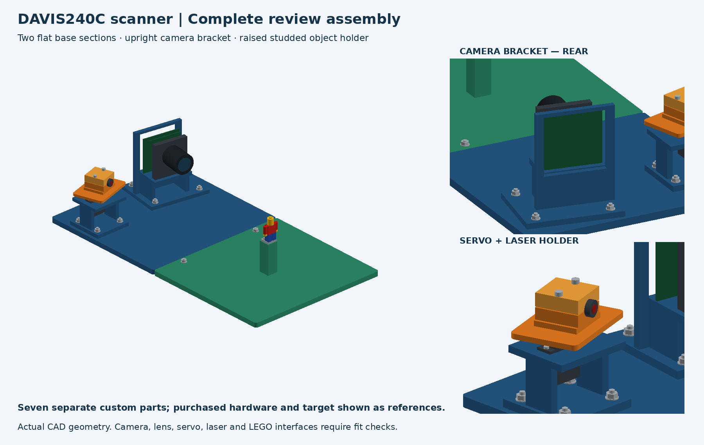
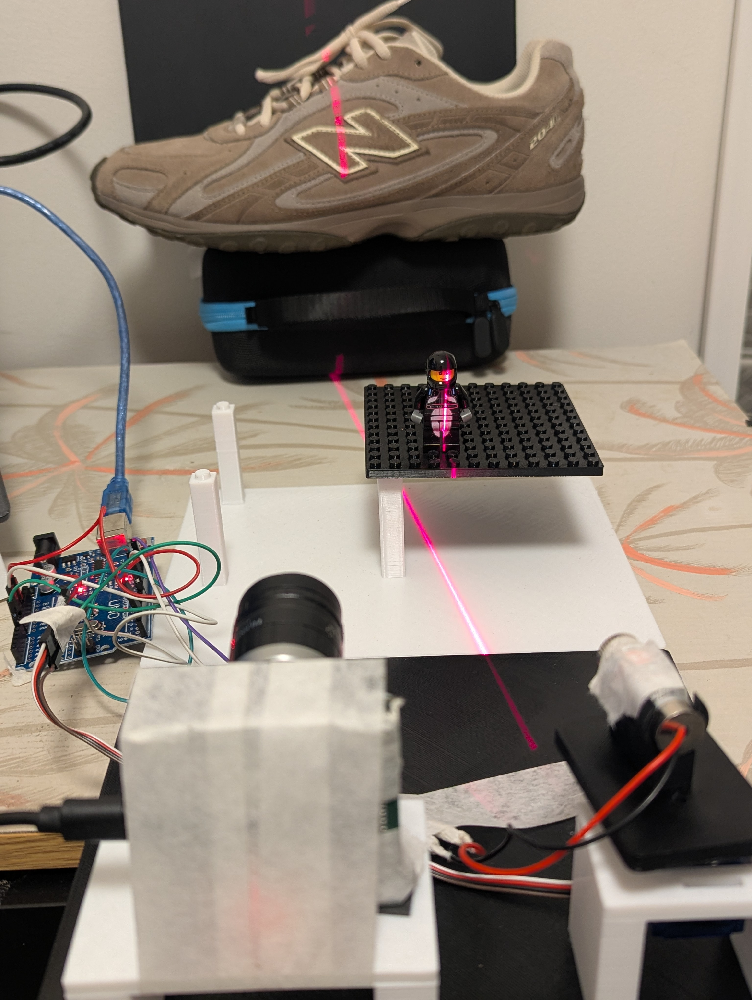
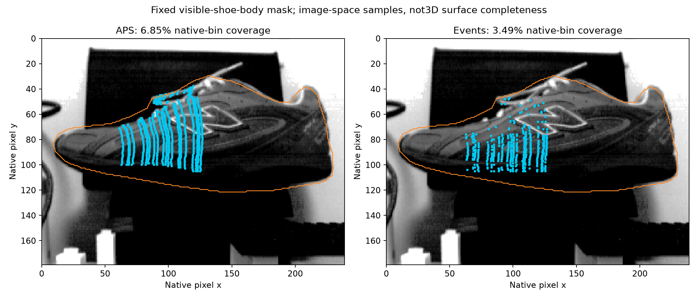

# Event-Based Structured-Light 3D Scanner

**MECH5720, The University of Sydney, 2026**

A team-built line-light scanner using a DAVIS240C hybrid event/grayscale camera and a feedback positional servo. We calibrate static laser planes and intersect them with camera rays to recover partial surface profiles. The demonstrated implementation uses **stop-and-pulse acquisition**. Continuous event-based scanning remains unvalidated.

[Reproduce a figure](#reproduce-a-key-result-without-hardware) | [Build guide](docs/BUILD.md) | [Results](docs/RESULTS.md) | [Evidence and gaps](docs/STATUS.md) | [Report draft](report/report_draft_20261103.pdf) | [Attribution](docs/ATTRIBUTION.md)

| Intended mechanical design | Implemented scanner |
|---|---|
|  |  |

The CAD view shows intended design with representative purchased components; the photograph documents the build. Dimensions and interfaces still require as-built verification.

## What we built

The custom base, upright camera bracket, servo support, rotating laser cradle, clamps and raised object pedestal add active geometric depth measurement beyond the course imaging labs. Firmware v1.7, a single-owner camera service and a Chrome Web Serial dashboard record bounded stationary pulses, feedback and native APS/events/IMU data.

For an undistorted camera ray **r** and a static plane **n** transpose **X** + d = 0, the reconstructed point is **X = -d r / (n transpose r)**. PWM command indexes a fitted plane; it is not a calibrated shaft angle. Continuous reconstruction needs a validated time-to-plane mapping.

## Measured results

| Quantity | Result | Interpretation |
|---|---|---|
| Candidate intrinsic training RMS | 0.2351 px | 17 training views; five previously inspected reserved views |
| Static plane calibration | 20 commands | Three fitting poses, separate reserved board D |
| Matched reserved-board depth RMS | Events 8.07 mm; APS 8.42 mm | 339 shared rows / 19 commands; shared camera model and reported scale |
| Partial shoe reconstruction | 960 APS points; 494 event points | 20 static positions; no full-shoe or absolute accuracy claim |
| Fixed-mask image-space sample coverage | APS 6.85%; events 3.49% | 13715 visible-body pixels; not true 3D area completeness |
| Repeatability | Three acquisitions at five commands | Position-dependent; no consistent event/APS winner |
| Unknown ND configuration | Digital signal ratio 0.4296 | Residual stripe shift; not optical transmission or a calibrated curve |



Both methods use the same scene/model/row support, but APS pools 35 ms frames and events use two 50 ms windows. Unequal integration, shared calibration and detector choices prevent an event speed/accuracy advantage claim. See [all metrics, conditions and failure cases](docs/RESULTS.md).

## Reproduce a key result without hardware

A small real-data example is included in this repository. It verifies the source-photo hash and regenerates the coverage image and numerical table using only retained point coordinates, photo and mask:

```powershell
python -m pip install -r requirements-offline.txt
python examples/coverage/regenerate.py
```

Expected output in `examples/coverage/regenerated_key_figure/`:

- APS: **939 / 13715 = 6.8465184105%**.
- Events: **478 / 13715 = 3.4852351440%**.

The script refuses existing outputs. No camera, serial connection or laser operation is performed. [Reproducibility guide](docs/REPRODUCIBILITY.md) explains dependencies, provenance, expected outputs and what the included subset cannot reproduce. The full native acquisition archive has no stable remote release yet.

## Build and run

Start with the [hardware/assembly and software guide](docs/BUILD.md), [CAD review source/STEP](hardware/cad_review/) and [operating contract](AGENT_RIG.md). Existing drivers, physical labels, wiring, beam containment and calibration must be checked before hardware operation. The reported prototype differs from the proposed laser/controller specifications; the guide records unresolved details rather than assuming proposal hardware was installed.

```powershell
python -m venv .venv
.venv/Scripts/python.exe -m pip install -r requirements.txt
.venv/Scripts/python.exe scripts/camera_ctl.py status
.venv/Scripts/python.exe scripts/rig_ctl.py status
```

Status clients inspect existing services. Do not run competing USB/serial owners or silently reconnect the Arduino; reconnect resets its position. Acquisition service startup and operator session enablement are described in the build guide. Saved-file analysis can run without taking hardware ownership.

## Repository map

| Path | Purpose |
|---|---|
| `event_camera/` | Camera I/O, timestamps, calibration, detector helpers and bounded control API |
| `scripts/` | Single-owner services, CLIs, capture tools and historical offline analysis scripts |
| `firmware/feedback_controller/` | Arduino controller, dashboard and legacy host logger |
| `hardware/cad_review/` | CAD builder, STEP assembly, validation and interface notes |
| `examples/coverage/` | Self-contained hardware-free key-result reproduction |
| `results/` | Curated numerical evidence and checksum manifest |
| `docs/` | Build procedure, metrics, limitations, verification and attribution |
| `report/` | Last checked 3 November LaTeX draft, figures and compiled PDF |
| `tests/` | Synthetic software/regression tests, not physical validation |

Local `.runtime/` tokens, authoring scratch directories, bulk raw captures and working output trees are excluded from new commits. Existing historical tracked files are preserved. Some pilot scripts hard-code local paths or dispatch hardware: read their source before running them. The older camera-only README is [archived](docs/archive/README_camera_milestones.md).

## Limitations and remaining work

Continuous event-based 3D reconstruction is not yet demonstrated: optical timing prediction residuals reached 47.55 ms and a moving-plane association has not been validated. Independent geometry accuracy, calibrated attenuation levels, true 3D completeness and complete as-built/rebuild verification also remain pending. They are not all blocked by continuous scanning. The report retains visible placeholders and explained negative results.

This public standalone repository is [AryanRai/mech5720-2026-event-scanner](https://github.com/AryanRai/mech5720-2026-event-scanner), derived from the team's original scanner repository by Aditya Solanki and the updated private fork `AryanRai/mech5720-2026-structured-light`. GitHub does not allow changing a private fork to public, so this copy starts from the reviewed project snapshot at commit `bdf07ec54bdb55d9ba90c700ac1893e37c0c7c85` without publishing the private Git history. The private fork remains intact. Its name and `mech5720` topic identify the unit/year. A stable full raw-data release and team-approved licence remain unresolved. Public visibility does not grant an open-source licence. [Status ledger](docs/STATUS.md).

## Team and credits

Aryan Rai, Aditya Solanki, Kailas Viswanathan Anilkumar, Nadeen Periyasamy and The Son Le. [Scientific/software/CAD/AI attribution](docs/ATTRIBUTION.md) records sources and contribution-review requirements.

Documentation organisation is informed by Don's [Ed guidance](https://edstem.org/au/courses/38151/discussion/3699857) and its [One Pixel BLE Camera](https://github.com/aboudou/onepixelblecamera) and [PlenoptiCam](https://github.com/hahnec/plenopticam) examples. No example-project code, images or results are reused.
