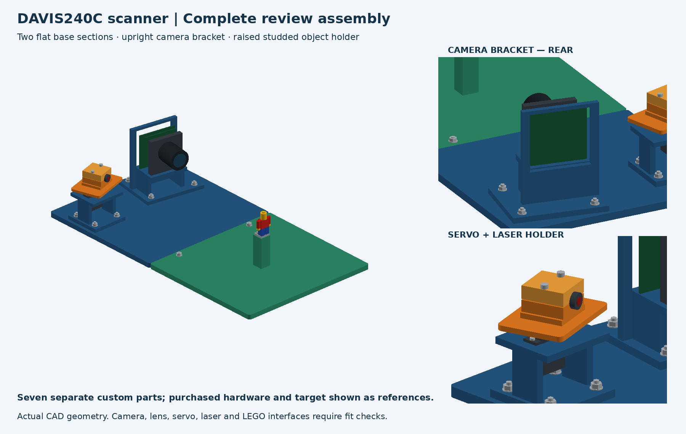
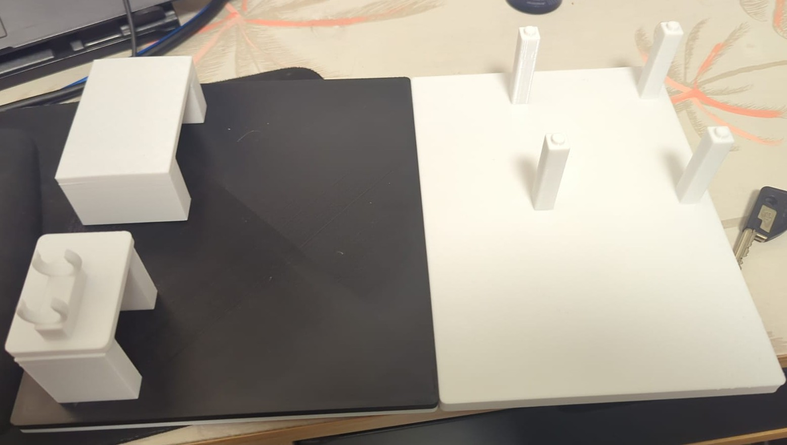

# Hardware and acquisition guide

This documents the demonstrated static scanner and unresolved build details. It is not a claim that a second rig can reproduce metric accuracy without calibration.

## Components and configuration

| Component | Recorded build | Verification still required |
|---|---|---|
| Camera | DAVIS240C, native 240 x 180 APS/events | Exact current optics and physical mounting datums |
| Lens | Earlier label Fujinon DF6HA-1B, 6 mm f/1.2 | Current spacer rings, focus and iris after physical changes |
| Controller | Uno R3-type clone, firmware v1.7 | Exact board label; proposal specified R4 |
| Actuator | Positional servo with separate analogue feedback | Installed model label and optical settling; no calibrated degrees |
| Projector | Reported eBay line laser; D7 supplies reported build | Exact product/class, driver, electrical design and approved controls |
| Power | User-reported external 5 V / 3 A supply | As-built distribution, grounding and driver |
| Target | Reported 9 x 6 inner corners, 18 mm pitch | Actual printed pitch, uncertainty and flatness |
| Attenuator | One unknown ND filter in front of laser | Marking/transmittance and geometry-preserving insertion |
| Structure | Team-designed base, upright camera bracket, fixed servo support, rotating cradle, clamps and raised object pedestal | Final as-built measurements and fit checks |

Parts references: [DAVIS](https://inivation.com/event-cameras/), [reported feedback-servo family](https://www.dfrobot.com/), [Arduino Uno R3](https://docs.arduino.cc/hardware/uno-rev3/). These links identify component families, not verified installed purchases. The proposed Picotronic laser and Uno R4 must not be substituted into the build description as if installed. Actual receipts, costs, laser specification and approved wiring remain team verification items.



The [CAD review source and STEP assembly](../hardware/cad_review/) are retained. This is intended design geometry with representative purchased components, not an as-built survey or universally compatible printable assembly. See its README for the seven custom parts and interface checks. The final horn was physically reindexed; do not assume the CAD horn interface or beam direction remains valid.



## Assembly procedure

1. Review the CAD assembly and check camera mounting, servo horn, laser diameter, screw clearances and pedestal interfaces against the actual components. Do not print reference camera/laser/servo solids.
2. Fabricate the custom structure; secure the camera and servo brackets, cradle and clamps. Document modifications with photographs. Measure the camera/projector datums, baseline and reference distance with instrument resolution and uncertainty.
3. Record the lens, rings, focus and iris. Keep them fixed through calibration and evaluation. Mount a flat target with measured square pitch.
4. Have the actual laser supply/driver/interlock arrangement checked before energising. Firmware pin assignments below describe signals; they are not approval to power a module from a GPIO.
5. Keep beams and reflections contained, the sensor outside direct exposure, and power disconnect accessible. Recheck containment after moving optics, filter, object or horn.

| Firmware connection | Pin | Meaning |
|---|---|---|
| Servo command | D9 | PWM signal |
| Analogue feedback | A0 | Raw/scaled ADC diagnostic, not shaft angle |
| Laser control | D7 | Controller output; actual driver/supply must be verified |
| Interlock input | D2 | Never bypass; verify actual circuit and operation |

Wire colours are not sufficient identification. Do not connect unverified 5 V synchronisation signals to DAVIS inputs. Earlier upstream firmware notes contain nominal ADC-to-degree descriptions that are superseded by the measured-command interpretation here.

## Software setup

The recorded environment is Python 3.12.14, dv-processing 2.0.4, OpenCV 5.0.0, NumPy 2.5.4 and Matplotlib 3.11.2. Reuse an existing environment when available. On a fresh Windows checkout:

```powershell
python -m venv .venv
.venv/Scripts/python.exe -m pip install -r requirements.txt
```

The DAVIS requires its installed USB driver/runtime. The hardware packages and recorded dependency versions have been exercised on the acquisition laptop; cross-platform installation is not established. Hardware-free reproduction has fewer dependencies: see [REPRODUCIBILITY.md](REPRODUCIBILITY.md).

## Single-owner startup

First inspect existing owners with `scripts/camera_ctl.py status` and `scripts/rig_ctl.py status`. Connection-refused means unavailable, not permission to create competing owners. Read [AGENT_CAMERA.md](../AGENT_CAMERA.md) and [AGENT_RIG.md](../AGENT_RIG.md) before operations.

If no owner exists, start `scripts/camera_agent.py --serial 60008401 --no-display` and `scripts/scanner_dashboard_server.py` in separate processes. The camera viewer is `http://127.0.0.1:8931/`; combined dashboard is `http://127.0.0.1:8933/scanner_dashboard.html`. Keep these loopback-only. Opening a page must not move hardware.

The operator connects the correct serial port in Chrome and explicitly enables the contained-rig session control. Connecting the Uno resets it and commands 1500 us: verify clearance first. No automatic reconnect or opt-in restoration. Restore and verify manual 35000 us exposure after camera restart if using the documented static conditions.

## Calibration and acquisition sequence

1. Reuse saved intrinsics only if optics/resolution match. The refined take06 candidate uses 17 training and five reserved views. Reserved views were inspected during diagnosis; they are not untouched tests.
2. Establish laser-off repeatability and optical settling over physically cleared travel. PWM/ADC values do not calibrate shaft angle.
3. Observe stripes on several posed boards per command, fit planes and freeze the model. The reported A--C model has 20 fitted commands; D was reserved. Do not refit on evaluation data.
4. At each held command, the v1.7 observation protocol uses 3 s dark, 1 s laser and 0.5 s post-dark, then off/disarm/release. A 12 s DAVIS recording includes margins. Feedback warnings are retained; completion does not prove optical settling.
5. Record run IDs, target/configuration, exposure, direction, filter, native timestamps, raw hashes and final status. Inspect uncertain operations before any new request. Never replay a timed-out operation under a new ID.
6. Test independently measured geometry before claiming absolute accuracy. A released servo is not a held calibration pose. Continuous reconstruction additionally needs a physically validated camera/servo timing and moving-plane mapping.

## Known pitfalls

- Whole-image dark fractions incorrectly reject normal black checkerboard squares; use board-region audits and inspect actual corner locations.
- Sector-based corner re-detection improved this candidate, but pixel reprojection RMS is not millimetre depth accuracy.
- Filter insertion/removal shifted the stripe. The old plane model must be rechecked before new depth claims.
- A 1627 us repeat set accidentally used an unfitted command; those records were retained/excluded and separately acquired 1626 us runs used instead.
- ND digital signal ratios are not optical transmission. One unknown filter cannot yield a calibrated attenuation curve.
- Background crossings and clipping affect stripe detection. High event activity is not confirmed laser detection.
- The host/browser is not safety-rated. Existing timeout and software envelopes do not establish safe physical travel or beam containment.

The outstanding parts/cost/driver/datums/optics verification is explicit in [STATUS.md](STATUS.md). The original source data remain retained locally; they are not deleted when generating a new audit.
