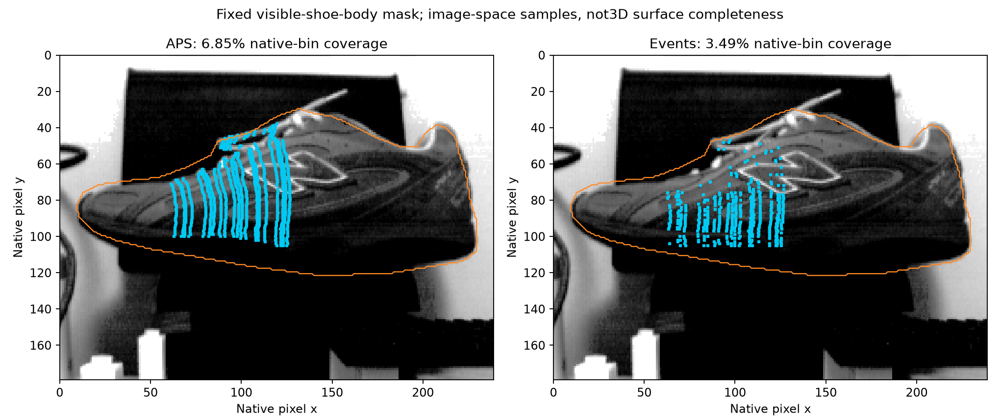
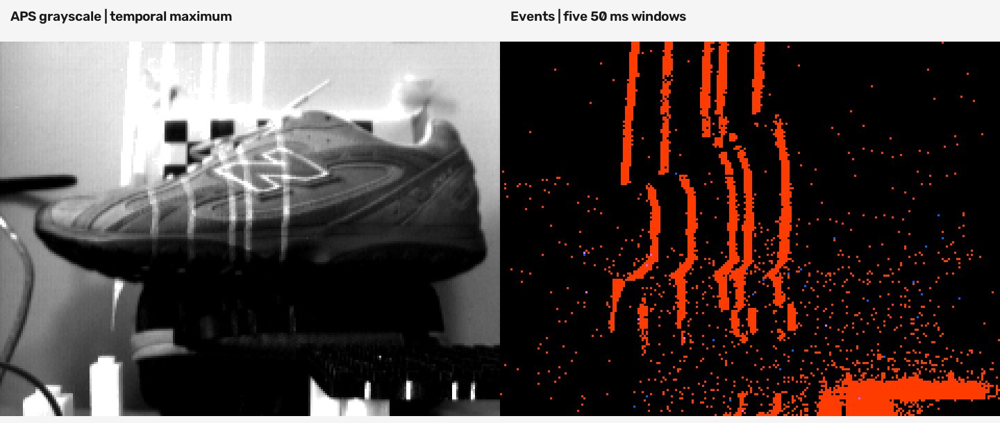

# Results and their limits

Evidence condition: November 2026 prototype, retained 2--3 November acquisitions. No later physical performance is inferred from this repository update.

| Result | Recorded value | Scope |
|---|---|---|
| Intrinsic training reprojection RMS | 0.2351 px | 17 views, provisional candidate |
| Reserved intrinsic per-view RMS | 0.1990--0.2965 px | Five previously inspected reserved views, fixed K/estimated pose |
| Static fitted planes | 20 commands, 1569--1647 us | 18 three-pose and two two-pose fits; no degree calibration |
| Reserved board D, matched support | Events 8.07 mm; APS 8.42 mm RMS | 339 common rows across 19 commands; shared K/reported target scale |
| Partial shoe samples | APS 960; events 494 | 20 commands, primary event windows 50 ms per transition |
| Shared shoe event/APS disagreement | 0.3385 px / 1.6497 mm RMS | 455 shared rows; agreement, not independent accuracy |
| Image-space sample coverage | APS 939/13715 = 6.85%; events 478/13715 = 3.49% | Same manual visible-body mask; not 3D area completeness |
| Static clock-prediction residual | Max absolute 47.55 ms | Includes optical/event-selection effects; no continuous-time validation |
| Unknown ND digital signal ratio | 0.4296 | n=2 recent no-filter / n=3 filter; residual displacement; not transmittance |

The common mask includes unsampled toe, heel and lower-body regions. Recovered-point counts alone cannot measure completeness. The image-mask boundary is approximate and post hoc; one-pixel perturbations give APS 6.64--7.06% and event 3.36--3.62%. These are sensitivity bounds, not statistical confidence intervals.

## Comparison conditions

APS uses actual DAVIS grayscale frames at 35 ms exposure, pooling selected lit frames. Event candidates use two 50 ms ON/OFF windows, paired by the known one-second pulse. The same recordings, geometry and row range are used, but temporal integration and photon budget differ. Neither event superiority nor speed advantage is established. An event accumulation image is a visualisation, not the APS baseline.

The original APS-only board evaluation was 8.63 mm across 20 commands. The 8.42 mm value uses the smaller matched support; this denominator change is not an improved calibration. The board pose shares intrinsics and reported 18 mm target pitch, so absolute independent ground truth is still missing.

## Repeatability

Three independent acquisitions at each command; each value is root mean within-row sample variance, expressed as SD in mm, using only rows retained by both methods in all trials.

| Command (us) | Common rows | APS (mm) | Events (mm) |
|---|---:|---:|---:|
| 1569 | 21 | 3.200 | 3.321 |
| 1590 | 14 | 3.040 | 0.463 |
| 1602 | 16 | 3.527 | 3.394 |
| 1626 | 8 | 0.031 | 0.641 |
| 1647 | 8 | 0.682 | 1.127 |

There is no consistent winner. Rows/events are correlated samples, not additional independent repeats. Background crossings, shared calibration and support selection limit interpretation. Precision is not accuracy.

## Filter experiment and failure

At fixed 1626 us and 35 ms exposure, recent no-filter controls retained APS 78/78 rows and event 20/18 rows. The unknown-ND retry retained APS 62/62/64 and event 0/1/0. The digital signal was 27.135 +/- 0.056 versus 11.657 +/- 0.088 levels (sample SD). About -0.95 px residual stripe displacement remains. Earlier insertion/removal had larger shifts; those conditions are not pooled. This is an explained failure of the current settings/condition, not a general event-camera light threshold.

## Different shoe datasets

| Dataset | Positions | Points | APS exposure |
|---|---:|---:|---:|
| Original sparse | 5 | 379 | 10 ms |
| Later directly fitted subset | 4 | 359 | 3 ms |
| Later interpolated-plane preview | 21 | 1929 | 3 ms |
| Frozen 20-plane APS scan | 20 | 960 | 35 ms |

Exposure, object distance, detector settings and model/crop differ; this is not a controlled accuracy comparison. Intermediate planes in the 1929-point preview are interpolated, not independently calibrated. No surface infill or mesh is counted as measurement.

The separate video demonstration recorded 821 APS frames and 284490 events across five held commands, ND removed, 35 ms APS exposure. These pictures combine different times. Event colours are unfiltered polarity activity including background, not confirmed detections; APS and event integrations differ. Feedback warnings occurred at 1602/1647 us. No new depth is claimed after filter handling.

## Evidence map

[results/evidence](../results/evidence/) retains candidate intrinsics, plane coefficients, reserved-board validation, event/APS comparisons, repeatability, coverage, ND and timing summaries. Their source paths identify the original local acquisition archive; the complete native archive is not yet remotely released. [REPRODUCIBILITY.md](REPRODUCIBILITY.md) distinguishes the included self-contained figure from raw-data reanalysis.
